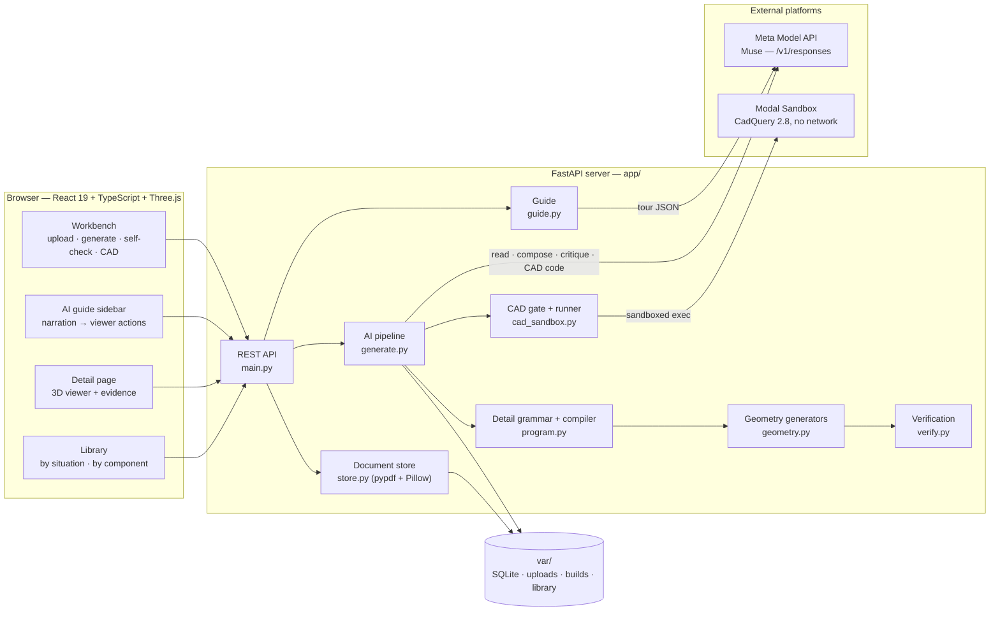
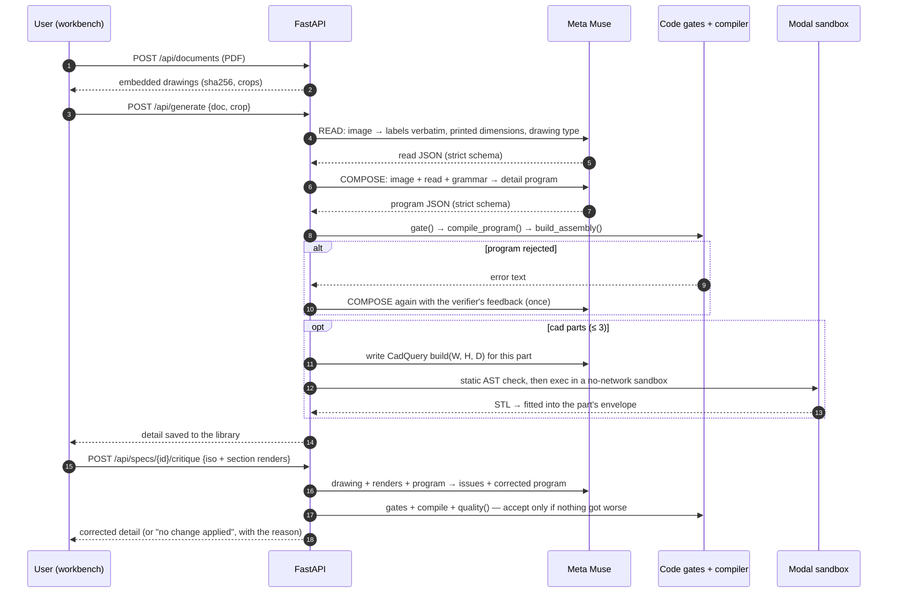

# Setout

**See how it should be built, before you build it.**

Waterproofing is the most common serious defect in NSW apartments: a NSW
Government study of 492 strata buildings found ~39% with serious defects, and 63%
of those were waterproofing. The correct detail usually exists — in a
manufacturer's PDF that nobody on site reads.

Setout is an **installation playground**. Give it a manufacturer's installation
document and it turns each drawing into an interactive 3D detail: the right parts,
in the right order, at the dimensions printed on the drawing — with every value
traceable to its source and an AI guide that walks you through the install by
moving the 3D for you.

Meta Global AI Developer Hackathon 2026 · Indie Developer Track · Build for Your World

**Live demo (read-only, with the AI guide):** https://pthebe-sfsu--setout-demo-web.us-east.modal.run

---

## Contents

1. [What it does](#1-what-it-does)
2. [Quickstart](#2-quickstart)
3. [Architecture](#3-architecture)
4. [How a drawing becomes 3D](#4-how-a-drawing-becomes-3d)
5. [Platforms and APIs used, and how](#5-platforms-and-apis-used-and-how)
6. [The honesty model](#6-the-honesty-model)
7. [REST API reference](#7-rest-api-reference)
8. [The detail grammar](#8-the-detail-grammar)
9. [Repository layout](#9-repository-layout)
10. [Development and testing](#10-development-and-testing)
11. [Evaluation, performance and cost](#11-evaluation-performance-and-cost)
12. [Known limitations and roadmap](#12-known-limitations-and-roadmap)
13. [Source documents, licensing and scope](#13-source-documents-licensing-and-scope)
14. [The NCC track](#14-the-ncc-track)

---

## 1. What it does

| Feature | What you see |
|---|---|
| **Library** (`/`) | Browse details **by situation** (sector › area › element, e.g. Residential › Internal · Bathroom › Floor + walls) or **by component / product** (every detail where a membrane, waterstop, floor waste… is installed). Cards show the source drawing, part count, drawing values and whether the detail is a human transcription or AI-generated. |
| **Detail page** (`#/d/<id>`) | Full-screen 3D: studio lighting, procedurally generated materials, a stepped cutaway that reveals each layer, drawing-label tags on every part, parts in install order, evidence per part (value, source, exact quote), and view / solo / explode / cut / install-step controls. |
| **AI installation guide** | A sidebar chat. Ask *"walk me through the install"* and the guide answers as a narrated tour that **drives the 3D**: it flies the camera to parts, isolates them, steps the install sequence, explodes and cuts. Every number it speaks is checked against the detail. |
| **Add from PDF** (`#/workbench`) | Upload any installation PDF. Embedded drawings are extracted. Pick one and press **Generate 3D with AI**: the model reads it, writes a detail program, code checks it, and the 3D is built and verified. An automatic **self-check** then compares a render with the drawing and corrects it. |
| **Review and publish** | Before an AI-generated detail is trusted, an expert reviews it: values printed on the drawing are listed first, each with its exact quote and the parts it drives (click to isolate them in 3D). Accept a value, fix it (every dimension computed from it moves too), set labels only to text printed on the drawing, then publish as *reviewed by <name>*. |
| **Drawing ↔ 3D link (SAM 3.1)** | The source drawing sits in a panel beside the 3D, turned upright. SAM 3.1 finds each part on it; click a box on the drawing to fly to that part, or select a part to light up its box. |
| **Model with AI (CadQuery)** | For a part the shape grammar can't express (a perforated grate, a mixer), the model writes CadQuery code that runs in an isolated, no-network sandbox. The result is labelled illustrative. |
| **Verification report** | Every detail ships with PASS / FAIL / UNVERIFIED / N/A checks: geometry built exactly as specified, drawing values actually driving geometry, labels verbatim, install sequence acyclic. |
| **Downloads** | `spec.json`, `scene.json`, `model.glb` (glTF, metres), `report.json`. |

The engine is **trade-agnostic**. Waterproofing is the first library because those
details are published, dimensioned and drawn; flashing, cladding, anchors and
insulation details use the same pipeline.

---

## 2. Quickstart

Requirements: Python 3.12+, Node 22+, and (for the AI features) a Meta Model API
key. CAD parts additionally need a [Modal](https://modal.com) account.

```sh
git clone https://github.com/pramodthe/setout && cd setout
python3 -m venv .venv && source .venv/bin/activate
pip install -r requirements.txt
(cd web && npm install && npm run build)

cp .env.example .env            # then set META_API_KEY (see below)
SETOUT_VAR=var python -m uvicorn app.main:app --port 8000
```

Open http://localhost:8000.

1. **Library** shows the two built-in door-sill details straight away (no key needed).
2. **+ Add from PDF** → upload an installation PDF → click a drawing →
   **Generate 3D with AI** (1–3 minutes) → the detail appears in the library.
3. Open any detail and ask the guide *"Walk me through the install"*.

### Configuration (`.env`, gitignored)

| Variable | Purpose | Default |
|---|---|---|
| `META_API_KEY` | Meta Model API key (dev.meta.ai). Required for every AI feature. | — |
| `MODEL_API_MODEL` | Model for read / compose / self-check / guide / CAD code | falls back to `META_MODEL` |
| `META_MODEL` | Secondary model setting | `muse-spark-1.3` if neither is set |
| `META_API_BASE` | API base URL | `https://api.meta.ai/v1` |
| `META_SAM_MODEL` | SAM model for the NCC perception kill-check | `sam-3.1` |
| `SETOUT_VAR` | Runtime storage (uploads, builds, library) | `var/` |

For CAD parts, log in to Modal once: `.venv/bin/modal token new`. Without it, CAD
parts fall back to plain boxes with a note — nothing breaks.

---

## 3. Architecture



| Layer | Technology | Role |
|---|---|---|
| Frontend | React 19, TypeScript 7 (strict), Vite 8, Three.js 0.149 | Hash-routed SPA: library, detail page, guide, workbench. Three.js viewer with `OrbitControls`, `RoomEnvironment` image-based lighting, PCF soft shadows, `CSS2DRenderer` labels. |
| Backend | Python, FastAPI 0.162, Pydantic 2.14, Uvicorn | REST API, background jobs (threads), compiler, mesh generators, verification, glTF export — all pure Python (no geometry kernel needed locally). |
| Storage | SQLite + files under `SETOUT_VAR` | Uploaded PDFs and extracted figures, build artifacts, the AI-generated library. Gitignored. |
| PDF handling | pypdf 6, Pillow 13 | Extracts embedded drawing images losslessly; re-encodes JPEG 2000 figures as PNG (browsers and the model API can't read JP2). |
| AI | Meta Model API — Muse (`muse-spark-1.3` by default) and SAM 3.1 | Muse reads drawings, writes detail programs, critiques renders, writes CadQuery and guides users; SAM locates parts on the drawing. |
| Sandbox | Modal Sandboxes + CadQuery 2.8 (OpenCascade) | Executes model-written CAD code in isolation, with networking blocked. |
| Testing | pytest, Vitest, Playwright | 96 backend tests (no network), 13 frontend tests, a headless browser acceptance pass. |

The browser never talks to Meta or Modal directly; API keys stay on the server.

---

## 4. How a drawing becomes 3D



**Step by step**

1. **Upload.** `store.py` checksums the PDF (sha256), extracts every embedded figure
   ≥ 200 × 200 px losslessly, and records page sizes. Nothing is rasterised or
   altered except JPEG 2000 → PNG.
2. **Read pass.** Muse receives the drawing image and returns, under a strict JSON
   schema: drawing type (section / isometric room / plan …), rotation, every label
   copied verbatim, and every printed dimension with its exact printed words.
3. **Compose pass.** Muse receives the image, the read, the grammar (§8) and a
   generic worked example, and writes a **detail program**: named parameters
   (value, provenance, quote) and parts whose dimensions are arithmetic
   expressions of those parameters (`floor + upturn_h`). It never writes geometry.
4. **Gates** (code, not model — `generate.gate`):
   - a parameter may claim `provenance: drawing` only if its quote appears in the
     read **and** its number appears in that quote; otherwise it is demoted to an
     assumption with a note;
   - a part label must equal a label from the read, verbatim, or it is dropped;
   - shapes, dimensions, ids and install order are normalised; at most 3 CAD parts.
5. **Compile and build.** `compile_program` evaluates the expressions with a
   whitelisted evaluator (numbers, names, `+ − × ÷`, `min`, `max` — nothing else),
   propagates provenance through every expression, and emits the canonical
   `DetailSpec`. Closed-set generators turn it into triangles. If anything fails,
   the error goes back to the model once.
6. **CAD parts** (optional). See §5.2.
7. **Drawing links (SAM 3.1).** The drawing is turned upright using the rotation
   the read pass reported (SAM finds nothing in a sideways drawing), then SAM is
   asked for each part by up to three short names: its drawing label, its type,
   and an everyday synonym ("bathtub", "floor drain", "sink"). The best box with
   confidence ≥ 0.5 is stored. Thin layers (membranes, screeds, slabs) are not
   prompted: SAM can't see them in a line drawing. If two parts claim the same
   box (a basin tap and a shower mixer both asking for "tap"), neither gets it,
   unless exactly one of them found it with its own drawing label.
8. **Verification.** `verify.py` checks structure, that each part was built exactly
   as specified (mesh bounds vs program, ±0.01 mm), that every drawing value drives
   some geometry, labels, products and install order.
9. **Self-check.** The browser renders iso and section views, stamps every part
   with its id, and sends them back. Muse compares them with the drawing and
   returns issues plus a corrected program. The correction goes through the same
   gates and is **accepted only if** failures don't increase and neither the
   number of drawing values driving geometry nor the number of verbatim labels
   drops. CAD parts are frozen. Every round is kept as a revision.
10. **Human review.** Nothing is marked *reviewed* until a named person has
    checked it. A reviewer's edits become `user_input`; a reviewer can never
    promote a value to "from the drawing" — only the gates can.

---

## 5. Platforms and APIs used, and how

### 5.1 Meta Model API (Muse)

All calls go through one small stdlib client, `app/meta_client.py`.

- **Endpoint:** `POST {META_API_BASE}/responses` (default `https://api.meta.ai/v1/responses`),
  `Authorization: Bearer $META_API_KEY`.
- **Streaming:** `stream: true`, `Accept: text/event-stream`; the client joins
  `response.output_text.delta` events and reads usage from `response.completed`.
  Errors (`error`, `response.failed`) are raised; transient network errors are
  retried once.
- **Structured output:** every call uses `text.format = {type: "json_schema", strict: true, schema}`,
  so the response is guaranteed to parse into the expected shape.
- **Image input:** drawings and renders are sent as `input_image` parts with
  `data:` URLs alongside an `input_text` part.
- **Model:** `muse-spark-1.3` by default (configurable; all listed Muse models
  support image input and structured output).

| Call | Where | Input | Output schema |
|---|---|---|---|
| **Read** | `generate.READ_SCHEMA` | drawing image | drawing type, rotation, labels (verbatim), dimensions (value + exact words) |
| **Compose** | `generate.PROGRAM_SCHEMA` | image + read + grammar + example | detail program (params, parts, unresolved) |
| **CAD code** | `generate.CAD_SCHEMA` | image + part brief + envelope | `{code, summary}` — CadQuery source |
| **Critique** | `generate.CRITIQUE_SCHEMA` | drawing + 2 renders + current program + read | issues `{part_id, problem, fix}` + corrected program |
| **Guide** | `guide.GUIDE_SCHEMA` | question + compact detail summary + history | steps `{say, actions[]}` + follow-up |

The NCC track (§14) uses the same endpoint for rule extraction and the benchmark.

### 5.2 SAM 3.1 (Meta segmentation)

`app/sam.py` links parts to the drawing.

- **Endpoint:** the same `POST /v1/responses`, model `sam-3.1`, one concept per
  request: an `input_text` prompt plus the drawing as an `input_image` data URL,
  with `metadata: {include_confidence: "true", mask_encoding: "one_bit"}`.
- **Output:** streamed text tokens, one record per object,
  `<0f>0<|box;x1=…;y1=…;x2=…;y2=…;w=…;h=…;c=0.91|><|mask;…|>`. We parse the box and
  confidence (masks are ignored) and store fractions of the upright image.
- **How:** rotate upright first (the read pass reports the rotation), try up to
  three names per part, keep the best box ≥ 0.5 confidence, run prompts in
  parallel. On a bathroom drawing, "bathtub" scored 0.92, "sink" 0.84, "floor
  drain" 0.80. A failed prompt finds nothing; nothing is guessed.

### 5.3 Modal Sandboxes + CadQuery

Used only when a part needs geometry the grammar can't express.

```python
# app/cad_sandbox.py (simplified)
image = (modal.Image.debian_slim(python_version="3.12")
         .apt_install("libgl1", "libglib2.0-0", "libxrender1", "libxext6", "libsm6")
         .pip_install("cadquery==2.8.0"))
sb = modal.Sandbox.create(app=modal.App.lookup("setout-cad", create_if_missing=True),
                          image=image, timeout=180, block_network=True,
                          cpu=1.0, memory=1024)
proc = sb.exec("python", "-c", script, timeout=120)   # script = our wrapper + model code
```

1. **Static gate first** (this process): the code is parsed with `ast`; imports
   are limited to `cadquery` and `math`; `exec`, `eval`, `open`, `__import__`,
   `getattr` and dunder attributes are rejected; `build(W, H, D)` must be defined.
   Rejected code never leaves the server.
2. **Isolated execution** (Modal): a fresh sandbox with **networking blocked**,
   1 CPU, 1 GiB, a 120 s run limit. The wrapper calls `build(W, H, D)`, exports an
   STL and prints it (base64) with its bounding box on stdout.
3. **Back on the server**: the STL is parsed, rotated from CadQuery axes (Z up)
   into ours (Y up) — a proper rotation, tested never to mirror — and fitted into
   the envelope the detail program reserved (uniform shrink only, recorded).
4. **Labelled honestly**: the part is marked *AI-modelled, illustrative*, its
   dimensions are assumptions, and verification only checks that it stays inside
   its envelope. The code and its sha256 are stored with the detail.

### 5.4 Modal (hosting)

The live demo runs the same FastAPI app as a Modal ASGI app
(`deploy/modal_app.py`): Python 3.12 image, the built frontend and `app/` added
as local directories, the library on a Modal Volume, and `SETOUT_PUBLIC=1`.
Public mode is read-only: no uploads, edits or generation; source drawings are
never served (they are third-party documents); the guide is rate-limited (60
questions per hour) so a public link can't drain the API budget. The guide is on
only when deployed with `SETOUT_DEMO_GUIDE=1`, which attaches the `setout-meta`
Modal secret holding the API key.

### 5.5 Three.js viewer

`web/src/viewport.ts` is a plain Three.js class driven by React:

- **Materials** are drawn by our own code at runtime (`web/src/materials.ts`):
  tileable value noise plus pattern passes for 22 material classes (concrete,
  screed, primer, membrane, tape, combed adhesive, tile and grout, sealant,
  aluminium, steel, timber, ceramic, glass…), mapped from each part's type, on
  box-projected UVs at real-world scale (`web/src/uv.ts`). No third-party
  texture assets.
- **Camera API** used by the guide: `flyTo(ids)`, `setView(iso | front | top | side)`,
  `isolate(ids)` (others ghosted), `playIntro()` (parts drop in, in install order),
  `snapshot(view)` (render + part-id tags, for the self-check).
- **Readability:** stepped cutaway (each layer starts further along the extrusion
  in install order; room floors step back to reveal the membrane), drawing-label
  tags with leader-line de-cluttering, explode, section clip, install-step playback.

### 5.6 Other libraries

FastAPI and Pydantic (API and schemas), pypdf and Pillow (PDF figures), SQLite
(job and document records), Playwright with system Chrome (acceptance test),
oxlint (frontend lint). Versions are pinned in `requirements.txt` and
`web/package-lock.json`.

---

## 6. The honesty model

A wrong dimension in a construction tool is worse than a missing one. So:

- **Provenance on every value**: `drawing` (confirmed against the printed words),
  `manufacturer_doc`, `user_input` (an explicit user edit), or `assumption`. It
  flows through expressions: a dimension computed only from drawing values and
  neutral datums is a drawing value; any assumption makes it an assumption.
- **Assumptions never verify.** They are shown in amber and excluded from
  dimensional checks.
- **Labels are verbatim or absent.** If the drawing doesn't name a part, its label
  is `null` — never invented.
- **No product claims.** Product references stay null until a manufacturer system
  is selected; the library says so.
- **AI output is labelled as such** (`origin: ai-generated:<model> (unreviewed…)`),
  and every AI step is followed by a code check: gates after compose, the quality
  guard after a self-correction, the grounding check after the guide.
- **The guide is grounded**: every number it speaks must be a parameter value, a
  drawing value, a number inside a quoted label, or a step number. Otherwise it is
  asked to answer again once; anything still ungrounded is flagged on that step.
- **CAD geometry is illustrative**, never a verified dimension.
- **No compliance verdicts.** Setout shows what correct looks like; it does not
  judge anyone's work.

---

## 7. REST API reference

| Method | Path | Purpose |
|---|---|---|
| `POST` | `/api/documents` | Upload a PDF (≤ 50 MB). Returns id, sha256, extracted figures. |
| `GET` | `/api/documents/{doc_id}` | Document metadata and figures. |
| `GET` | `/api/documents/{doc_id}/figures/{crop_id}` | One extracted drawing image. |
| `GET` | `/api/library` | All details with situation, counts and components, plus the component index. |
| `GET` | `/api/specs` | Detail summaries (id, title, crop, document sha, origin). |
| `GET` | `/api/specs/{id}` | The full canonical spec. |
| `PATCH` | `/api/specs/{id}` | User correction of a parameter or label (recorded as `user_input`). |
| `GET` | `/api/specs/{id}/scene` | Build + verify now; returns the viewer payload. |
| `GET` | `/api/specs/{id}/drawing` | The source drawing, upright (alias `/thumb`); 404 if not uploaded here. |
| `GET` / `POST` | `/api/specs/{id}/preview` | Library card image: a JPEG render of the 3D, saved by the viewer once the build-up finishes. Cards never show the source drawing. Readable in public mode. |
| `GET` | `/api/specs/{id}/review` | Review state: values (printed first) with quotes and the parts they drive, labels, what the checks changed. |
| `POST` | `/api/specs/{id}/review` | `{edits, accept, labels, publish, reviewer}`; edits recompile the program. |
| `POST` | `/api/specs/{id}/locate` | SAM 3.1: locate parts on the upright drawing (job). |
| `POST` | `/api/builds` | Background build job → artifacts. |
| `GET` | `/api/builds/{job_id}` | Build state and progress. |
| `GET` | `/api/builds/{job_id}/artifacts/{name}` | `spec.json`, `scene.json`, `model.glb`, `report.json`, `error.txt`. |
| `GET` | `/api/eval/{job_id}` | Verification grouped by stage A / B / C. |
| `GET` | `/api/ai/status` | Whether the AI and the CAD sandbox are configured, and the model. |
| `POST` | `/api/generate` | AI: generate a detail from `{doc_id, crop_id}` (job). |
| `POST` | `/api/specs/{id}/critique` | AI: self-check from `{renders: [data URLs]}` (job). |
| `POST` | `/api/specs/{id}/cad` | AI: re-model one part in CadQuery, `{part_id}` (job). |
| `POST` | `/api/guide` | AI: guide answer for `{detail_id, question, history}` (job). |
| `GET` | `/api/generate/{job_id}` | Poll any AI job: state, progress lines, result. |

---

## 8. The detail grammar

Almost every installation detail is published as a section or an isometric
drawing. One grammar (`app/program.py`) covers both:

- **Parameters**: `{name, value, unit, provenance, source_quote, kind}` where kind
  is `exact`, `min`, `max` or `datum`.
- **Parts**: `{id, type, label, shape, dims[], path[], install_after[], note}` where
  every dim is an expression over parameter names.

| Shape | Dims | Used for |
|---|---|---|
| `box` | x0 x1 y0 y1 [z0 z1] | walls, slabs, layers, membrane zones, angles |
| `sheet` | path (x, y) + thickness | membranes and flashings following a section |
| `profile` | path (closed outline) [z0 z1] | any shaped cross-section: hobs, channels, sills, trays |
| `revolve` | path (radius, y) + cx cz | wastes, flanges, tap bodies |
| `sweep` | path (x, y, z) + r | pipes |
| `post` / `rod` | cx cz r y0 y1 / cx cy r | vertical / horizontal cylinders |
| `wedge` | x0 x1 y_bottom y_top_x0 fall_ratio | screeds laid to falls |
| `fillet` | x y leg_x leg_y | coves, bond breakers |
| `fixture` | envelope + `bath`, `shower_tray`, `wc`, `basin`, `vanity`, `door` | recognisable fixtures generated inside a sized box |
| `cad` | envelope + brief | AI-modelled CadQuery part (illustrative) |

Axes: millimetres, `+x` right, `+y` up, `+z` toward the viewer. Rooms put the
origin at the inside back-left corner at floor level; sections are extruded along z.

---

## 9. Repository layout

```
app/                     FastAPI backend
  main.py                REST API, background jobs
  program.py             detail grammar v2, expression evaluator, compiler
  generate.py            AI pipeline: read, compose, gates, CAD stage, critique
  meta_client.py         Meta Model API client (streaming, strict JSON schema)
  cad_sandbox.py         CadQuery static gate, Modal runner, STL fitting
  guide.py               AI guide: tour schema, grounding check
  review.py              human review and publish
  sam.py                 SAM 3.1 part location on the drawing
  library.py             library index by situation and component
  geometry.py            closed-set mesh generators, GLB and scene export
  verify.py              verification checks and report
  spec.py                canonical DetailSpec v1 (Pydantic)
  seed.py                two human-transcribed door-sill details
  store.py               PDF store and figure extraction
web/                     React + TypeScript frontend (Vite)
  src/Library.tsx        library front page
  src/DetailView.tsx     detail page
  src/Guide.tsx          AI guide sidebar
  src/ReviewPanel.tsx    review and publish panel
  src/App.tsx            workbench (add from PDF, AI generate / check / CAD)
  src/viewport.ts        Three.js viewer and camera API
  src/materials.ts       procedural material library
tests/                   pytest (96 tests, no network)
eval/batch_eval.py       run the AI pipeline over every drawing in a PDF
deploy/modal_app.py      hosted public demo on Modal
e2e/drive.py             headless browser acceptance pass
docs/                    plan, status log, earlier audit and architecture notes
ncc/                     original NCC shower-details track (see §14)
scripts/                 NCC regen / viewer helpers
data/                    local manuals and footage (gitignored)
```

---

## 10. Development and testing

```sh
python -m pytest tests/ -q                       # 96 tests, Muse, SAM and Modal stubbed
python -m pytest tests/test_cad.py -q            # one file
cd web && npm test                               # Vitest (materials, UVs, provenance)
cd web && npx tsc -b && npm run lint             # type-check + lint
cd web && npm run dev                            # Vite dev server, /api proxied to :8000
python e2e/drive.py                              # browser acceptance (server running,
                                                 # system Chrome, reference PDF at /tmp/conpro_sills.pdf)
```

What the tests cover: the expression evaluator (including code-injection
attempts), provenance flow, every shape and fixture, the gates (demotion, verbatim
labels), the CAD static gate and STL/axis handling, the self-check acceptance
rule, the guide's grounding retry and flagging, the library and scene endpoints,
and the original spec, geometry, verification and API suites.

---

## 11. Evaluation, performance and cost

**Batch evaluation** (`eval/batch_eval.py`, details in `docs/EVAL.md`): the full AI
pipeline on all 24 drawings of a 22-page wet-area waterproofing guide.

| Measure | Result |
|---|---|
| Generated and built | **24/24** (16 sections, 7 room isometrics, 1 other) |
| Verification FAILs | **0** |
| Printed values confirmed against the drawing | **86** (55 drive geometry) |
| Distinct drawing labels used verbatim | **173 of 221** (78%) |
| Values the gates had to demote | **0** |
| Median time / tokens per drawing | **111 s** / **~30k** |

"Confirmed" means the read and compose passes agree on the printed words and
number; whether a value sits on the *right part* is what the review screen is
for.

Measured on real drawings with `muse-spark-1.3`:

| Step | Time | Tokens |
|---|---|---|
| Generate one detail (read + compose) | 54–212 s, median 111 s | median ~30k (24 drawings) |
| Self-check round | ~1–2 min | not yet measured |
| CAD part (Modal) | 20–40 s (first run ~45 s while the image builds) | not yet measured |
| Guide answer | ~20–40 s | not yet measured |
| Build + verify a detail (no AI) | < 1 s | — |

---

## 12. Known limitations and roadmap

- The model sometimes attaches a printed dimension to the wrong part. The gates
  stop invented numbers, not misplaced ones; the review screen is where an
  expert catches them (it shows every part a printed value drives).
- SAM finds discrete objects (baths, basins, wastes, taps) on line drawings, not
  thin layers, so only some parts get a drawing link.
- Section proportions can read flat; the self-check helps but isn't guaranteed.
- Parts are axis-aligned prisms, revolutions, sweeps or fixtures; doubly curved
  products rely on the illustrative CAD path.
- Product references are not assigned (no manufacturer system data yet).
- Jobs run in-process; AI jobs are kept in memory and lost on restart (the
  generated details themselves are saved).
- Later: AR on site (point a phone at a junction — SAM 3.1 perception is
  prototyped in the NCC track) and photoreal renders.

---

## 13. Source documents, licensing and scope

**Never commit the documents the details come from.** No PDFs, no verbatim
clause text, no screenshots of manual pages. Uploaded documents and everything
generated from them live under `SETOUT_VAR` (gitignored). Short factual drawing
labels are quoted in the evidence panel with their source. Full rule:
`.claude/rules/source-documents.md`.

Deliberately out of scope: measuring real installations from photos, compliance
verdicts on real work, model training, IFC/BIM export, accounts and catalogues.

Licence: Apache-2.0 (see `LICENSE`). Your own work only — the hackathon requires
you to own everything you submit.

---

## 14. The NCC track

The original track encodes **31 rules from NCC 2022 Part 10.2** (wet areas) as
structured data and generates three shower details from them, every solid carrying
the rule id that set its size.

```sh
scripts/regen.sh                                              # rebuild NCC scenes
scripts/regen.sh --violate membrane_return_onto_floor_mm=20   # demo a failing rule
python3 ncc/extractor/validate_rules.py                       # schema lock
python3 ncc/benchmark/run.py --dry-run                        # benchmark, no API calls
```

Then open `ncc/viewer/index.html` (works from `file://`). The benchmark asks a model
31 code questions: with `muse-spark-1.3`, 35% correct from memory, 100% with the
rules in context. See `ncc/SPEC.md`.
