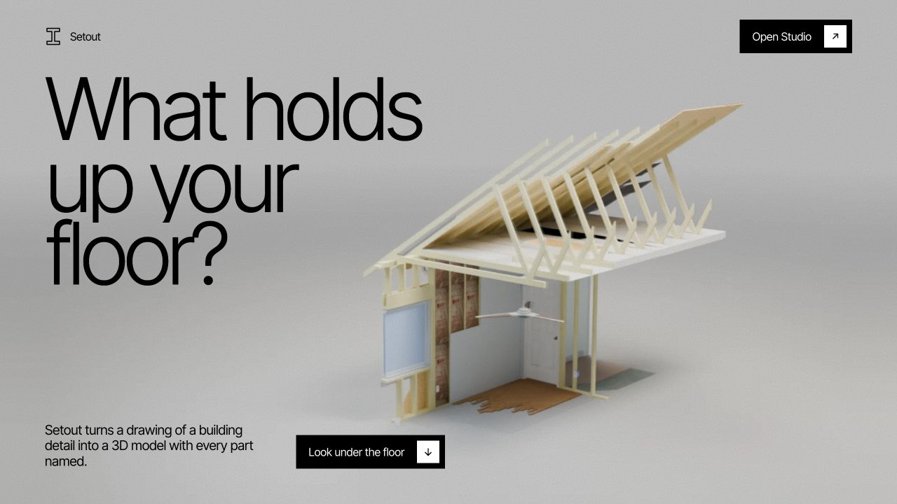

# Setout

**A playground for construction details.**

Give Setout a drawing of how something is built, and it makes a 3D model you can turn, take apart and
step through. Every part is named, and you can watch the detail go together.

The landing page starts with a house cutaway: an ordinary room conceals layers of structure, services and
connections. It follows one floor connection to show why granular construction details matter. The house
is a visual story; the Studio builds one local detail at a time from an uploaded drawing.



It works from one 2D section or a picture of a detail, for any trade. Waterproofing is what we test it
on, because those details are among the hardest to read: thin layers, hidden laps, and parts a section
can't show. A tool that can follow them should manage most others.

Meta Global AI Developer Hackathon 2026 · Indie Developer Track · Build for Your World

## What you can do

- **Build from a drawing.** Drop in a PDF, PNG or JPG. Muse works out what the detail is, including the parts
  a section can't show, and builds the local assembly.
- **Explore it.** Isometric, front, side and top views, a scene tree of named parts with their sizes,
  pull apart, and a step-by-step playback of the build.
- **Change it.** Tell Muse what's wrong, and it edits the scene it already has. Undo steps, rename a scene, or delete it.
- **Take it with you.** Download any model as a GLB file. When finishing is enabled, switch between
  textured 3D and a studio render, and download the image too.

## How it works

Muse doesn't generate a mesh. It writes Blender Python, one small step at a time, against a live scene:

```
Drawing ──> Muse reads it ──> writes a step ──> Blender runs it in a sandbox
                                   ^                       │
                                   └── renders and errors ─┘
                                             │
                              Muse asks to finish
                                             │
                         checker compares it with the drawing,
                         from five sides, and may send it back
                                             │
                        GLB export ──> three.js viewer in the browser
```

- **The model writes the 3D.** `builder/kit.py` holds generic shapes only. Parallel builds can also
  place suitable whole meshes from the owner's library, without stretching or scaling them.
- **Parallel building is experimental.** Select **Try parallel build** before uploading. One shared
  assembly plan defines interfaces; up to three component calls run concurrently. The assembled scene
  becomes interactive while it is checked independently, and gets at most one visual repair pass. Findings
  are saved in backend diagnostics. Feedback uses the existing step-by-step builder.
  Invalid programs or self-crossing sheets are rejected; bounded repairs can still dominate total time.
  This path is not yet a demonstrated end-to-end speed or fidelity improvement.
- **A scene is its list of code steps,** replayed in order. Undo is instant, feedback carries on from the
  same scene, and every size stays readable as a named value.
- **The checker is independent.** It lists what the drawing shows before any 3D exists, then ticks each
  item from renders. It never sees the builder's words, and code decides from the ticks. Missing, wrong,
  or uncertain details and invented parts prevent a pass. A repair that scores worse restores the earlier
  checked scene. The step-by-step builder allows three repair refusals; parallel builds allow one visual repair.
- **Small details can be inspected.** Muse can crop the original drawing and frame close-ups of model parts.
  The checker gets its own enlarged cut-face views, and lighting separates faces and joints more clearly.
  Builds reserve tokens for a final check; an unchecked revision never inherits an earlier model's pass.
- **Measuring stands beside it.** Before any 3D exists, Muse also reads how the drawing's parts relate. Code then
  measures the model: what floats, what passes through what, and whether each relation holds. It tests touching,
  order and overlap, never a size. It never changes the verdict and never reaches the builder. Its findings
  are saved alongside the checker report for debugging, outside the viewer.
- **Model code is sandboxed.** It passes a static check, then runs in Blender on Modal with no network.
- **Viewing costs nothing.** The viewer uses three.js and saved assets in your browser. Optional finishing
  runs Blender once in the background after a build; Modal rendering incurs normal service usage.

## Quickstart

You need Python 3.13 or newer, Node 24, a [Meta Model API](https://dev.meta.ai/) key and a
[Modal](https://modal.com/) account.

```sh
python -m venv .venv && source .venv/bin/activate
pip install -r requirements.txt

cp .env.example .env            # add META_API_KEY

modal token new                 # once
modal deploy builder/sandbox.py

(cd web && npm ci && npm run build)

python -m uvicorn app.main:app --port 8000
```

Open http://127.0.0.1:8000 for the house story, then choose **Open studio** to upload a drawing at
`/#/app`. Existing detail scenes remain at `/#/studio/<id>`. A build takes about 5 to 15 minutes.

The house film and model assets are generated locally under `web/public/assets/anatomy/` and ignored by Git.
For a fresh checkout or deployment, generate or supply those assets before building the web app; see
[the landing-page render instructions](web/ANATOMY.md). The Studio upload page remains available at `/#/app`.

A `var/` folder from before the Studio-only release can't be upgraded. The app says so when it starts: move
that folder away and it starts with an empty one.

### Optional studio rendering

Export `SETOUT_RENDERER=local` in the server/worker environment to use an installed Blender (or specify
its executable with `SETOUT_BLENDER`), for example `SETOUT_RENDERER=local python -m uvicorn app.main:app --port 8000`.
For a server without Blender, deploy `modal deploy builder/render_sandbox.py` and set `SETOUT_RENDERER=modal`.
This is off by default. New or revised scenes become interactive first; a separate worker then bakes surface
textures and makes one still. The interactive model gains its finished materials automatically; the
**Realistic 3D / Image** switch offers an optional still. Existing models have an **Enhance 3D** action in the
Studio, and failed finishing can be retried there without rebuilding geometry. Both embedded workers and
`python -m app.worker` run separate build and render lanes; `--lane render` can run the renderer on its own.
Failures leave the original model available. The finishing pass changes presentation, not geometry or
checker results; it cannot supply missing fixings or other unmodelled detail. Existing scenes are not
automatically reprocessed. `POST /api/studio/{id}/presentation` starts their finishing job; repeated clicks
reuse a pending or completed result. The Modal finishing service is separate from the generation sandbox.

## Backend diagnostics

The checker still runs during generation; its report and the later geometry measurements stay out of the
viewer. They are saved in SQLite with each scene. Read the saved findings, model notes, progress feed, token usage and
current build/measurement job logs without starting work:

```sh
curl -s http://127.0.0.1:8000/api/studio/SCENE_ID/diagnostics | python -m json.tool
```

## Layout

```
app/                The server
  main.py           HTTP routes
  studio.py         Scenes: upload, build, feedback, undo
  worker.py         Runs build jobs, safe to restart
  repository.py     Jobs, leases and token budgets
  model_gateway.py  Budgeted, checkpointed model calls
  store.py          Finds the drawing in a PDF
builder/            The 3D
  loop.py           Muse's tools, and what it's told
  hybrid.py         Shared assembly plan and concurrent component generation
  library.py        Imports the owner's standard parts from DAE/ZIP files
  checker.py        The independent check, and the contract it reads
  measure.py        How the parts meet, from the geometry alone
  kit.py            Generic shapes, materials and renders
  sandbox.py        Headless Blender on Modal, with no network
web/src/            Landing story and Studio, in React, TypeScript and three.js
migrations/         Database schema
tests/              Python tests, with the model and sandbox stubbed
```

## Development

To populate the optional hardware library, run `python -m builder.library /path/to/your/models`.
Only use models you own. It writes under `var/library/`; set the process environment variable
`SETOUT_LIBRARY` to use another folder. A saved parallel scene embeds the exact selected meshes in
its steps, so replay and undo work even if the library later changes. No library means procedural
geometry throughout. Neither method verifies dimensions or guarantees source fidelity.

```sh
python -m pytest tests/ -q            # no network needed
cd web && npx tsc -b && npm run lint  # type-check and lint
npm test                            # frontend logic regressions; no network
npm run dev                           # dev server, /api proxied to :8000
```

Scenes live in a SQLite database and files under `SETOUT_VAR` (default `var/`). Set `SETOUT_WORKER=external` and
run `python -m app.worker` to keep the worker apart from the server.

## Limits

- **Nothing here is verified.** Sizes are assumptions chosen by the model, because detail drawings aren't to
  scale, and every scene says so. Don't build from it without checking the source.
- **It can be wrong.** Muse can misread a drawing or add a part that isn't there, and the checker is a model too.
- **Models are simpler than hand-made ones.** They show how a detail goes together, not every fixing.
- **Complex geometry remains unreliable.** Recent parallel drain and sliding-door tests produced viewable
  models but failed their source checks. Openings, mating profiles and library placement still need review;
  extra polygons do not establish greater accuracy.
- **One build at a time.** A second upload waits in the queue.
- **It gives no compliance verdict.** It shows a detail, and doesn't grade real work.

## Licensing

Apache-2.0, see [LICENSE](LICENSE). Blender (`bpy`, GPL-3.0) runs as a separate service in the sandbox and
isn't distributed with this code.

Drawings, manuals and standards aren't ours to publish. `data/` and `*.pdf` are gitignored, and
[the rule is here](.claude/rules/source-documents.md).
